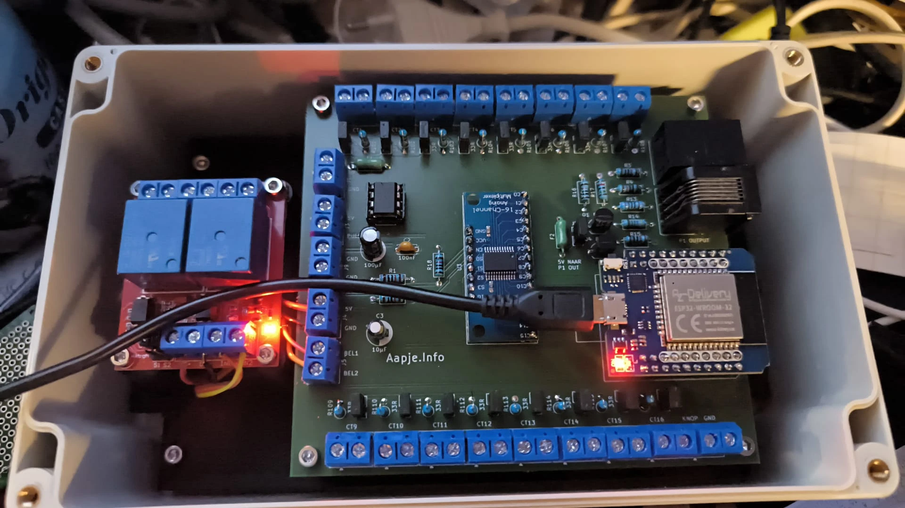
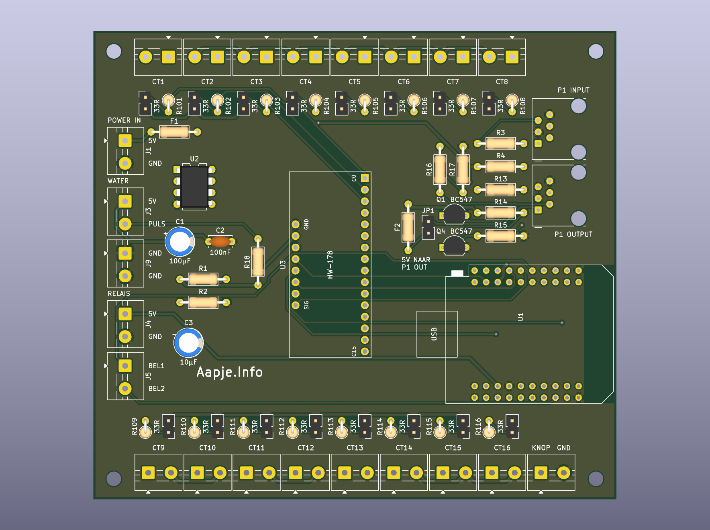
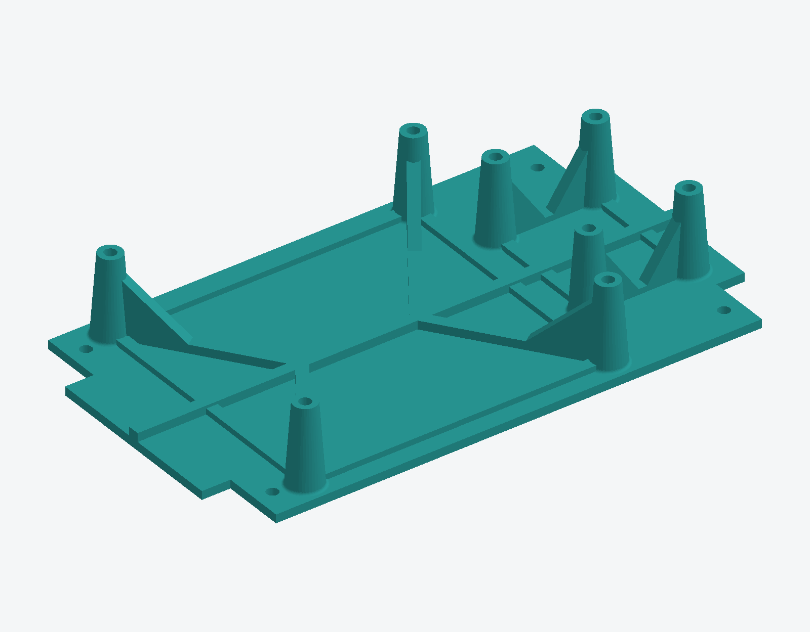
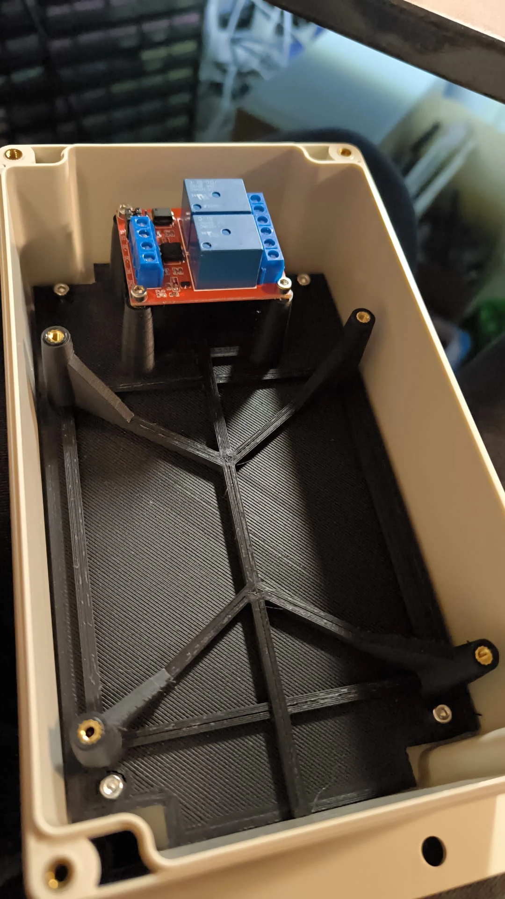

# ESP32CT

**16-channel CT-clamp energy monitor with P1 in/out** (ESP32, ESPHome, KiCad), and a bit of help of Claude.




[Hardware](#hardware-overview) · [Mount](#mount-3d-printed) · [Firmware](#firmware-esphome) ·
[Calibration](#calibrating-the-ct-channels) · [Build it](#building-the-board) ·
[Open points](#status-and-known-open-points) · [Support](#support-the-project)

## What it is

A through-hole PCB that turns an ESP32 into a whole-house energy monitor for
[ESPHome](https://esphome.io) and Home Assistant. Clip a current clamp on each circuit in your
meter cupboard and see what your dryer, oven, EV charger and heat pump use separately.

- **16 CT-clamp channels** through one CD74HC4067 analog multiplexer and the ESP32's ADC
- **P1 input** (RJ12) to read a Dutch/Belgian smart meter (DSMR)
- **P1 output** (RJ12) that imitates a smart meter, so an EV charger can be load-balanced
  against values you choose (developed against an Alfen charger)
- **Water meter** pulse input (inductive 5 V NPN sensor)
- **Doorbell** button input and two relay outputs via an external relay board

It started as a hand-wired board in a meter cupboard and was redesigned as rev C, a
115 × 103 mm two-layer board that anyone can order and assemble with through-hole parts only.
Free to use; if it helps you and you would like to support future projects you can
[donate via aapje.info](https://aapje.info/donations/), never required.



More views: [bottom render](hardware/esp32ct-revc/render_bottom.png), the
[schematic](hardware/esp32ct-revc/esp32ct-revc.pdf) and the
[placement drawing](hardware/esp32ct-revc/plaatsing.pdf). A photo of the installation
(clamps on the distribution board) is still to be added.

## Why this design

- **Universal channels.** All 16 channels are identical. Which circuit is clamped on
  which channel is wiring and firmware, not silkscreen.
- **Burden resistor with a jumper per channel.** Each channel has a 33 Ω burden in
  series with a jumper. Closed: bare ring CT (e.g. GTA20L1.0, 1000:1). Open: a clamp
  with a built-in burden (e.g. SCT013-015 or -050). A jumper *across* the burden would
  short the clamp, so it is wired in series.
- **Short, quiet measurement loops.** CT terminals sit opposite each other along the
  two long edges, each with its burden and jumper directly behind it.
- **1.65 V mid-rail** from an LM358 voltage follower as the bias for all channels.
- **Everything external on screw terminals** (5.00 mm), except the two RJ12 jacks.
- **Fusing.** F1 protects the whole 5 V supply; F2 (200 mA) protects the 5 V on the
  P1-output pin so a short in the charger cable does not take the board down.
- **No strapping pins in use.** The multiplexer's S1 line is on GPIO4, not GPIO12
  (a strapping pin that can stop the module from booting). A check fails the build if
  anything is ever connected to GPIO0/2/5/12/15.

## Hardware overview

| Item | Detail |
|---|---|
| Board | 115 × 103 mm, 2 layers, FR4 1.6 mm, HASL, 4 × M3 holes |
| MCU | ESP32 D1-mini-style module (footprint of the MH-ET Live MiniKit, `mhetesp32minikit`; the prototype uses an AZ-Delivery ESP32-WROOM-32 of the same form factor), at the right edge with the antenna pointing outward and a copper keep-out under it |
| Mux | HW-178 CD74HC4067 breakout, plugged into two female headers (15.24 mm row spacing) |
| CT channels | 16 × 2-pole screw terminal (YIXISI, 5.00 mm), 33 Ω burden + jumper each |
| Power | 5 V in on a screw terminal, 1 A slow fuse |
| P1 in | RJ12, BC547 inverter to GPIO18, data request on GPIO23 |
| P1 out | RJ12, GPIO17 through a BC547 inverter to an open-collector line with 4k7 pull-up to 5 V |
| Water | 5 V inductive NPN sensor, pulse on GPIO32 with 10k pull-up to 3.3 V |
| Relays | Not on the board; a two-channel Arduino relay board connects with four wires |

Full pin map: [`hardware/PINMAPPING.md`](hardware/PINMAPPING.md).

### Pin summary

| GPIO | Function |
|---|---|
| 13 / 4 / 14 / 27 | Multiplexer address S0 / S1 / S2 / S3 |
| 34 | Multiplexer signal (ADC1) |
| 18 / 23 | P1 in: RX / data request |
| 17 / 16 | P1 out: TX / data request from the charger (optional) |
| 32 | Water meter pulse |
| 33 / 25 | Doorbell relay house / garage (active low) |
| 26 | Doorbell button |

## Mount (3D printed)

The board and the external relay board sit on a printed base plate with four conical
standoffs for the main board (brass heat-set inserts) and posts for the relay board.
Latest version: **R13 "kastgaten"** (holes for the enclosure screws, 4 mm, 158 × 90 mm
pitch), 190 × 110 × 31 mm, designed in Fusion.



| File | What |
|---|---|
| [`3dhouse/ESP32CT_PCB_houder_R13_kastgaten.stl`](3dhouse/ESP32CT_PCB_houder_R13_kastgaten.stl) | print this |
| [`3dhouse/ESP32CT_PCB_houder_R13_kastgaten.step`](3dhouse/ESP32CT_PCB_houder_R13_kastgaten.step) | editable solid for any CAD program |
| [`3dhouse/ESP32CT_PCB_houder_R13_kastgaten.f3d`](3dhouse/ESP32CT_PCB_houder_R13_kastgaten.f3d) | Fusion source with the feature timeline |
| [`3dhouse/PCB Holder v5.stl`](3dhouse/PCB%20Holder%20v5.stl) | earlier version (v5), 190 × 110 × 43 mm |

**Enclosure:** the prototype lives in this junction box (clear lid):
[Amazon.nl listing](https://www.amazon.nl/Aansluitdoos-aansluitdozen-elektronicaprojectdoos-aansluitkast-transparante/dp/B0CZ6CYHLS).
The holder is made to fit it; check the inner dimensions of the box you buy against the model
before printing.



The printed holder (black, ribbed baseplate) in the enclosure. The four board standoffs
carry brass heat-set inserts, and the relay board sits on its own posts at the top.
Which exact version is shown in the photo is not recorded.

## The PCB is generated, not drawn

Schematic, netlist, placement, routing and Gerbers are all produced by scripts in
[`hardware/`](hardware/) with KiCad 10 and Freerouting:

```bash
bash build.sh
```

This regenerates the schematic, checks the netlist, runs ERC, places and routes the
board, runs DRC, and exports drawings, BOM and Gerbers. The checks it runs itself
(netlist, layout) stop the build on failure. Errors reported by KiCad's export steps are
not yet caught (known issue), so check the ERC/DRC reports and the Gerbers before
ordering. Result of the last full run: **0 ERC, 0 DRC, 0 unconnected items.**

Do not edit the KiCad files by hand or save from KiCad: the next build overwrites them.
Change the scripts (`sheets.py` for the schematic, `pcb.py` for placement) instead.

### Checks that exist because something went wrong

`check_net.py` verifies more than "the schematic agrees with itself":

- the ADC pin, the address bus, all sixteen CT chains, the bias rail, and that every
  burden jumper is in series, not in parallel;
- a list of pins that may float; everything else unconnected is an error;
- a **physical pin assignment** block that enforces the real pinout of the real parts
  (LM358, BC547, HW-178), with the source of each.

That last block exists because, during design, three symbols turned out to have
invented pin numbers (CD74HC4067, LM358, BC547). The schematic was consistent, ERC was
clean, and the board would never have worked. If you reuse the symbols, read
[`hardware/OPEN_PUNTEN.md`](hardware/OPEN_PUNTEN.md).

## Firmware (ESPHome)

The reference configuration is [`firmware/esp32ct-revc.yaml`](firmware/esp32ct-revc.yaml) (copy `firmware/secrets.yaml.example` to `secrets.yaml` first). Highlights:

- One shared `cd74hc4067` hub on GPIO13/4/14/27 with the ADC on GPIO34. Two hubs on the
  same address lines break each other's pin cache and give impossible readings.
- Per ring channel: moving average first (window 6), then quadratic noise subtraction
  `sqrt(measured² − floor²)`, then `calibrate_linear`, then a low cut-off. The order
  matters: smoothing must come before the subtraction.
- DSMR/P1 reader, water meter (`pulse_meter`), gas total, doorbell with mute switches.
- **P1 output.** Number entities on the device (`P1 Out …`): signed power per phase
  (negative = export), tariff, fallback voltage and four kWh counters. Every second it
  builds a DSMR 5 telegram with CRC-16/ARC and writes it to UART2 on GPIO17 (115200
  8N1, *not* inverted in software; the transistor does that). Voltage comes from the
  real P1 input when valid. The output only transmits while the switch `P1 Out Aan` is
  on. After a reboot it returns to the last chosen state (by design), so a board that was
  transmitting keeps transmitting.

CT calibration curves and noise floors in the configuration belong to one installation
(ring CTs with 33 Ω, about 0.031 V/A fitted). **Measure your own.**

## Calibrating the CT channels

The board measures the voltage across the burden, not current. Firmware turns that
voltage into amperes per channel. Procedure used in this project:

1. **Start from the theoretical sensitivity** (volts per ampere at the ADC input):

   | Clamp | V/A |
   |---|---|
   | ring 1000:1 with 33 Ω burden (jumper closed) | 0.033 theoretical, about 0.031 fitted |
   | SCT013-015 (15 A / 1 V, built-in burden, jumper open) | 0.067 |
   | SCT013-050 (50 A / 1 V), one pass of the conductor | 0.02 |
   | SCT013-050, two passes (both in the same direction, insulated wire only) | 0.04 |

   Amps = measured volts ÷ V/A (for the 50 A clamp: ÷ (0.02 × number of passes)).
   These are theoretical values; real clamps deviate, so always measure.
2. **Measure the noise floor** with the conductor carrying no load: take the RMS
   reading of the channel (volts). On this installation about 0.042 V on the ring
   channels, which is roughly 1.4 A. Higher sensitivity clamps give a lower floor in
   amps (about 0.6 A for the 15 A clamp), but the floor is installation dependent.
3. **Filter order matters:** moving average first, then quadratic noise subtraction
   `signal = sqrt(measured² − floor²)`, then the linear calibration, then a cut-off
   (0.04 A here). Subtracting before smoothing works on an unstable value and gives
   unusable results.
4. **Fit the curve with known loads.** Switch on a load whose current you know or can
   measure with a reference (a plug-in energy meter or a Shelly, in this project) and
   read the channel's smoothed voltage. Use several loads across the range and enter
   the pairs in ESPHome as `calibrate_linear` points (voltage → amps), for example
   0.006 → 0, 0.109 → 3.45, 0.178 → 5.19, 0.263 → 8.48 for one ring channel.
5. **Re-check after any change** of clamp, burden or jumper. Closed or open jumper
   gives a completely different curve.
6. **Power** is `current × 230 V`. There is no voltage measurement and no phase
   information, so power factor is ignored and **direction cannot be seen**. A group
   with both load and generation shows the difference.

The ADC of an ESP32 is not linear near its limits; stay well within the clamp's range
for the channel (see the table below) and calibrate at the currents you care about.

| Clamp | Approximate range at the ADC |
|---|---|
| ring with 33 Ω | about 35 A |
| SCT013-015 | about 17 A |
| SCT013-050, one pass | about 58 A |
| SCT013-050, two passes | about 29 A |

Ranges and noise floors for the SCT013 clamps are estimates, not measurements.

## Building the board

1. Order `esp32ct-revc-gerbers.zip` from any fabricator (2 layers, 1.6 mm, HASL).
2. Check before you order, see [`hardware/OPEN_PUNTEN.md`](hardware/OPEN_PUNTEN.md):
   - row spacing of your HW-178 (15.24 mm)
   - wire entry direction and width of your screw terminals (≤ 10.7 mm per block;
     terminals sit on a 10.795 mm pitch)
   - GPIO16/17 on your MiniKit
   - that your relay board switches properly at 3.3 V on IN
3. Flash the ESP32 over USB **before** the HW-178 goes in; the USB connector is blocked
   afterwards. Later updates go over the air.
4. For clamps with a built-in burden (SCT013) leave the channel jumper **open**; for
   ring CTs close it. A channel with no clamp should keep its jumper **closed**,
   otherwise the mux input floats.

## Network security

The example configuration has no OTA password and no web-server login, which is common
on a trusted home network. Anyone who can reach the device can update its firmware and
operate it. Add `password:` to `ota` and `auth:` to `web_server` (with entries in your
`secrets.yaml`) if your network is not trusted.

## Documentation language

The README is in English. The detailed hardware notes in `hardware/` (`README.md`,
`OPEN_PUNTEN.md`, `PINMAPPING.md`, `PCB_BESCHRIJVING.md`) are still in Dutch; translations
are welcome. Silkscreen text on the board is Dutch too.

## Status and known open points

Rev C has been built and is running, but this is a hobby project made for one house.
Honestly open:

- The firmware builds a DSMR 5 telegram with CRC-16/ARC for the P1 output, but the
  actual output signal, a loopback test into the board's own P1 input, and
  acceptance by the EV charger are all **unverified**.
- A CT sees magnitude only, not direction. A circuit with both load and generation
  (e.g. solar on the same group) reads the *difference*.
- Some values in the power and P1 sheets are conventional designs, not measured from
  the original board: the 1.65 V divider, LM358 supply (3.3 V vs 5 V), bulk
  capacitors, the P1 inverter resistors, and whether P1 data-request may connect
  directly to a 3.3 V GPIO.
- Screw-terminal wire entry direction was derived from the footprint, not measured.
- Whether the charger expects DSMR 5 (115200 8N1) or DSMR 2/3 (9600 7E1).
- **Electrical safety.** The board itself only carries extra-low voltage, but CTs go
  around mains conductors; clamp only insulated conductors. A bare ring CT (1000:1,
  current output) with an open secondary develops dangerous voltage while primary
  current flows. On this board, opening a channel jumper (JP101-JP116) on a **ring-CT
  channel** is exactly that case: never open it while the conductor carries current.
  Only clamps with a built-in burden (SCT013 xA/1V) may have the jumper open.

## Repository layout

```
hardware/        KiCad generation scripts, checks, build.sh, docs
  esp32ct-revc/  generated KiCad project, Gerbers, drawings, BOM
  lib/           third-party footprints with provenance
firmware/        ESPHome configuration (rev C) and secrets.yaml.example
3dhouse/         3D-printable mount (STL)
```


## Licence

See [`LICENSE.md`](LICENSE.md).

| Part | Licence |
|---|---|
| Hardware, documentation, photos, 3D mount | [CERN-OHL-W-2.0](https://ohwr.org/cern_ohl_w_v2.txt) |
| Firmware (`firmware/`) | MIT |
| Third-party parts in `hardware/lib/` | their own licences (see Credits) |

You may build, use, modify and sell boards from these files. Changes to the hardware
design must be shared under the same licence. The hardware is provided without any
warranty; you are responsible for safe installation on your own mains wiring.

## Support the project

This board is a hobby project, free to use. If it saved you time or money and you
would like to help fund future projects, a donation is very welcome (never required):

- Donate via [aapje.info/donations](https://aapje.info/donations/)

Building a board and reporting what you found (photos, measurements, fixes) helps
just as much: please open an issue or a pull request.

## Credits and third-party material

- ESP32 MiniKit footprint from
  [r0oland/ESP32_mini_KiCad_Library](https://github.com/r0oland/ESP32_mini_KiCad_Library)
  (Apache-2.0), copy and licence text in `hardware/lib/`.
- Screw-terminal footprint derived from KiCad's MaiXu MX126 with a tighter courtyard.
- Symbols for LM358 and BC547 verified against KiCad's own libraries; HW-178 pinout
  verified against SparkFun's board file.
- Built with KiCad 10, Freerouting and ESPHome.
